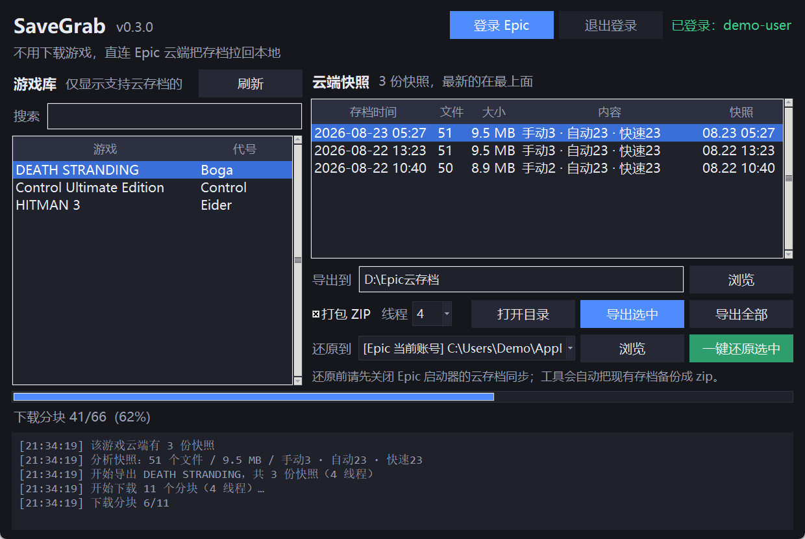

# SaveGrab

> Export and restore Epic Games cloud saves **without downloading the game**.
> 中文说明见 [README.md](README.md)。



## What it does

- **No game install needed** — talks to Epic's cloud-save service directly (no 70 GB download)
- **Snapshot preview** — see file count, size and save slots (manual / auto / quick) before exporting
- **Multi-threaded download** — 2/4/6/8 workers with retries
- **One-click restore** — resolves the local save folder automatically and zips a backup of your existing saves first
- **Multiple accounts / platforms** — detects Epic accounts, Steam accounts (17-digit IDs) and accepts any custom folder
- **CLI mode** — `--cli-export` / `--cli-restore` for scripting

## Download

Grab `SaveGrab_v*_win64.zip` from [Releases](../../releases), unzip it and run `SaveGrab.exe`.
No Python installation required.

## Run from source

```bat
python build\fetch_vendor.py
python main.py
```

Requires Python 3.10+. `fetch_vendor.py` pulls `legendary-gl` and its dependencies into `vendor/`.

## How it works

```
Epic OAuth (authorization code) -> access token
        |
        +- Library: entitlements + catalog -> customAttributes.CloudSaveFolder
        |
        +- Cloud saves: GET /api/v1/access/egstore/savesync/{account_id}/{app_name}/manifests/
                          |
                          +- each *.manifest lists chunks + files for one snapshot
                          +- download chunks from readLink, decrypt, reassemble files
```

- Built on top of [Legendary](https://github.com/legendary-gl/legendary)'s Python API (an open-source
  Epic Games Launcher replacement), but bypasses its CLI so it can be embedded in a GUI and frozen with PyInstaller.
- Save paths come from Epic's catalog metadata, e.g. Death Stranding (app name `Boga`):
  `{appdata}/../locallow/KojimaProductions/DeathStranding/{EpicID}/`

## Limitations

- Works only with games that declare `CloudSaveFolder` in Epic's catalog (the tool filters the rest out)
- Saves are bound to the account that created them — moving them to another account/platform may show
  "corrupted data". SaveGrab does not patch game executables
- Uses undocumented Epic endpoints; a server-side change can break it

## License

GPL-3.0-or-later (because it bundles/derives from Legendary, which is GPL-3.0).
Third-party notices: [THIRD_PARTY_NOTICES.md](THIRD_PARTY_NOTICES.md).

Not affiliated with Epic Games. Use it only to export **your own** saves.
