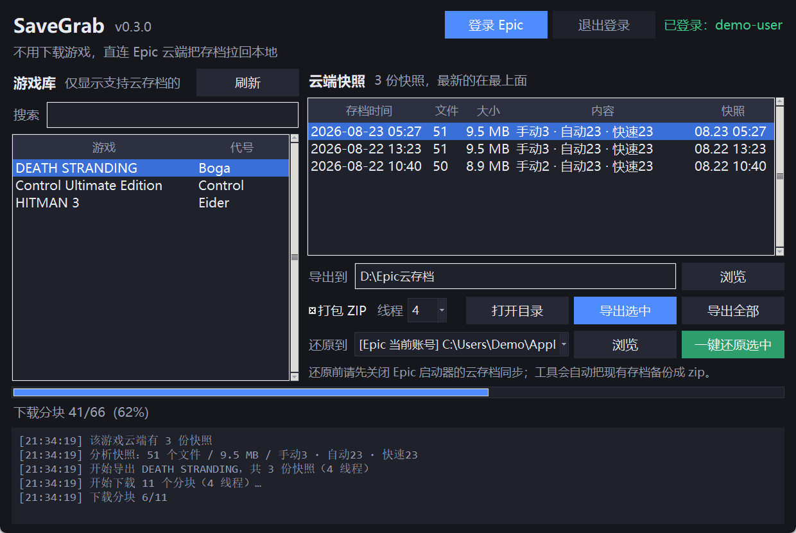

# SaveGrab

[](https://github.com/poey-xj/SaveGrab/actions/workflows/build.yml)
[English](README.en.md) · [下载最新版](https://github.com/poey-xj/SaveGrab/releases/latest) · [FAQ](docs/FAQ.md)

> 不用下载游戏本体，直接连 Epic 云端，把你在 Epic 买的游戏的云存档拉回本地。
> 起因：想备份/迁移《死亡搁浅》的云存档，发现 Epic 官方启动器根本没有「导出」这个功能。



## 它能做什么

- **免装游戏导出云存档**：只读 Epic 的云存档服务，不需要 70G 的游戏文件
- **自动列出账号里所有支持云存档的游戏**，点一下就能看到云端有几份快照
- **导出前先看清楚**：每份快照有多少文件、多大、包含几个手动/自动/快速存档槽
- **多线程下载**（2/4/6/8 可选），比单线程快几倍
- **一键还原到本机**：自动识别 Epic 存档目录，还原前把现有存档打包备份成 zip
- **支持 Steam / 其他账号的目录**：自动扫描同级账号文件夹（17 位 SteamID64 / 32 位 EpicID），
  也可以手动指定任意目录，方便跨平台迁移或从旧账号搬到新账号
- 可选打包 ZIP；登录会话保存在本地，下次打开免登录

## 不能做什么（先说清楚）

- 不是破解，也不是盗号工具：只能读**你自己已登录账号**的云存档
- **跨账号/跨平台不会自动绕过存档校验**：死亡搁浅这类游戏的存档和账号绑定，换账号直接放进去
  会提示「存档损坏」。工具只负责把文件还原到目标目录，要不要改游戏 exe 请自行判断（有风险）
- 不能保证所有游戏都能导出：只对「Epic 目录里配置了 `CloudSaveFolder`」的游戏有效，工具会自动过滤
- 依赖 Epic 的非公开接口，Epic 改接口就可能失效

## 怎么用

### 导出

1. 双击 `SaveGrab.exe`
2. 点右上角「登录 Epic」→ 打开 Epic 登录页 → 登录 → 把返回的 JSON 整段粘贴进来 → 登录
3. 左边选游戏 → 右边选快照（能看到文件数/大小/槽位）→「导出选中」或「导出全部」

### 还原（一键写回本机）

1. 先在 **Epic 启动器 → 设置里关闭云存档同步**（重要，否则可能被旧云档覆盖）
2. 选游戏 → 右边选中**一份**快照
3. 「还原到」下拉框会列出自动检测到的本机目录（Epic 当前账号 / Steam 账号 / 其他），
   也可以点「浏览」手动指定
4. 点「一键还原选中」→ 确认 → 工具先备份现有存档（存到
   `%LOCALAPPDATA%\SaveGrab\backups\`），再写入
5. 进游戏确认能读档 → 再回启动器把云存档同步打开

### 命令行（调试/自动化）

```bat
SaveGrab.exe --cli-export Boga D:\saves
SaveGrab.exe --cli-restore Boga "%USERPROFILE%\AppData\LocalLow\KojimaProductions\DeathStranding\<EpicID>"
```

### 源码运行（需要 Python 3.10+）

仓库里不提交 `vendor/`（避免二进制进 git），第一次先跑依赖脚本：

```bat
python build\fetch_vendor.py
python main.py
```

`fetch_vendor.py` 从 PyPI 拉取 legendary-gl 0.21.1 及其依赖到 `vendor/`，不依赖 pip 的安装流程。

## 发布

见 [PUBLISH.md](PUBLISH.md)：注册 GitHub → 建仓库 → 上传源码 → 发 Release（exe 放附件，别提交进 git）。

## 实现原理（给好奇的人）

```
Epic OAuth（授权码） → access_token
        │
        ├─ 游戏库：entitlements + catalog，读 customAttributes.CloudSaveFolder
        │
        └─ 云存档：GET /api/v1/access/egstore/savesync/{account_id}/{app_name}/manifests/
                    │
                    ├─ 每份 *.manifest 记录「这个快照由哪些 chunk 组成、还原成哪些文件」
                    └─ 按 readLink 多线程下 chunk → 解密 → 按 file_manifest 拼回原始文件
```

- 底层用的是开源项目 [Legendary](https://github.com/legendary-gl/legendary) 的 Python API
- 但**不走它的命令行**，而是直接调 API（命令行会开多进程日志队列，不利于 GUI 集成和打包）
- 存档路径模板来自 Epic 目录元数据，例如《死亡搁浅》（内部代号 `Boga`）：
  `{appdata}/../locallow/KojimaProductions/DeathStranding/{EpicID}/`
- 还原时把模板里的 `{appdata}` `{epicid}` 等替换成本机值，再扫描同级目录判断
  哪个是 Epic 账号、哪个是 Steam 账号（17 位数字）/ 其他

## 开发 / 打包

```bat
python main.py --selftest          :: 界面自检并截图（需要 Pillow）
python main.py --selftest-login    :: 含登录弹窗的截图

python build\fetch_build_tools.py  :: 准备 PyInstaller 到 build_tools\
build\build_exe.bat                :: 打 exe
```

打包要点：`legendary` 是**静态** import 进 exe 的（`vendor` 会加进 `PYTHONPATH` 参与分析），
这样 PyInstaller 才能把它的标准库依赖收全。不要把 `vendor` 目录当 data 打包——
那样运行时会绕过打包的依赖解析，出现 `No module named 'uuid'` 之类的错误。

目录结构：

```
savegrab/
├─ main.py              # tkinter 界面 + 命令行入口
├─ epic_core.py         # 登录 / 游戏库 / 快照分析 / 下载 / 还原
├─ vendor/              # 源码运行时的 legendary 及其依赖（GPL-3.0）
├─ assets/app.ico       # 图标
├─ build/               # 打包、依赖下载（fetch_vendor.py）、图标生成脚本
├─ docs/视频脚本.md      # B 站视频大纲
├─ PUBLISH.md           # 发布到 GitHub 的完整步骤
└─ preview.png          # 界面截图
```

## 许可与声明

- 本项目以 **GPL-3.0-or-later** 发布（因为内置了 GPL-3.0 的 Legendary，属于衍生分发）。
  发布时请附上完整源码和 `LICENSE`，并在页面注明使用了 Legendary。
- `vendor/` 内各依赖的许可证见 `THIRD_PARTY_NOTICES.md`。
- 只用于导出/备份**自己账号**的存档。请不要拿去做账号共享、代练、售卖存档等用途。
- 和 Epic Games 没有关系，使用风险自负；重要存档请多备份几份。
